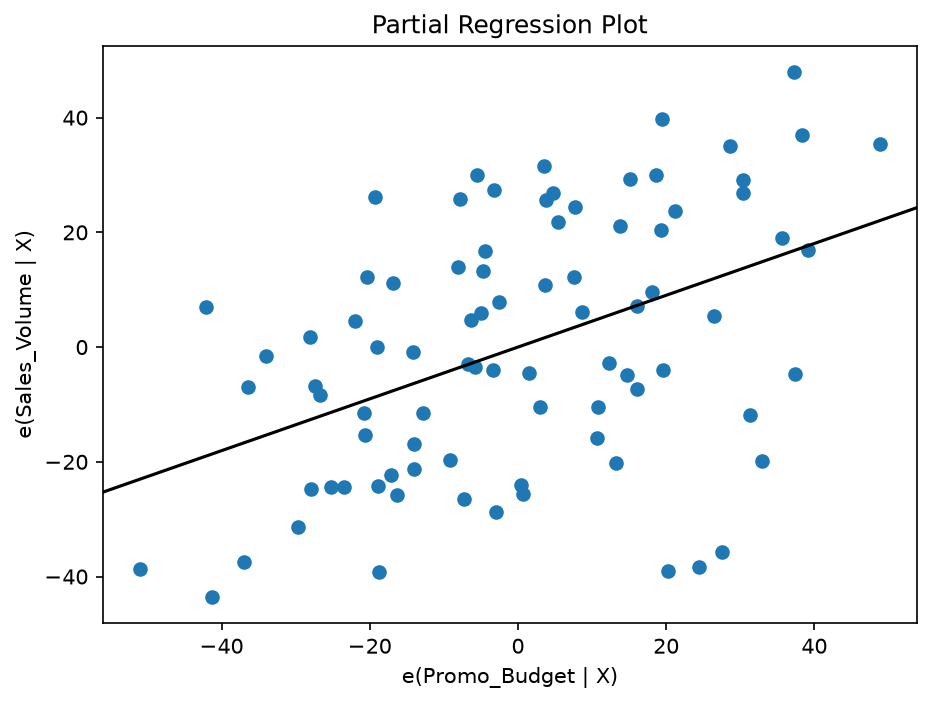

# Econometric Analysis of Pharma Sales Elasticity & Promo-Mix Optimization

## 📋 Описание бизнес-кейса
Проект решает стратегическую задачу коммерческого департамента и бренд-команд в фармацевтическом секторе — оценку эффективности промо-микса (Marketing Mix Modeling / MMM). 

Скрипт анализирует влияние маркетингового бюджета на объемы продаж бренда (SKU) в региональных аптечных сетях с одновременным контролем активности конкурентов и сезонных/региональных факторов. Главная фишка проекта — полная автоматизация отчетности «под ключ» для кросс-функциональных команд.

## Итоговая структура репозитория:
pharma-marketing-mix-regression/
├── examples/                     # Примеры файлов, которые создает скрипт
│   ├── promo_mix_report.xlsx
│   └── promo_mix_presentation.pptx
├── images/                       # Скриншот слайда для превью в README
│   └── slide_preview.png
├── pharma_sales_regression.py    # Основной скрипт
├── requirements.txt              # Список библиотек Python
└── README.md                     # Описание проекта + превью слайда

## 🛠 Что делает данный скрипт:
1. **Препроцессинг данных**: Загружает выгрузки розничного аудита и приводит их к формату аналитических матриц с помощью библиотеки `patsy`.
2. **Эконометрическое моделирование**: Строит множественную линейную регрессию методом наименьших квадратов (OLS) на базе `statsmodels`. Оценивает изолированное влияние инвестиций на продажи, очищая данные от шума и внешних факторов.
3. **Автоматизация бизнес-отчетности (Data Engineering)**: 
   - **Для аналитиков и закупщиков**: Автоматически формирует детализированный файл Excel (`.xlsx`) со всеми статистическими метриками и коэффициентами эластичности.
   - **Для бренд-менеджеров и директоров**: Напрямую генерирует готовую презентацию PowerPoint (`.pptx`) с автоматическими выводами, ключевыми инсайтами и графиком чистой эластичности продаж.

## 💻 Стек технологий
Python (pandas, statsmodels, patsy, matplotlib, python-pptx, openpyxl).
## 📊 Пример автоматического отчета (PowerPoint)

